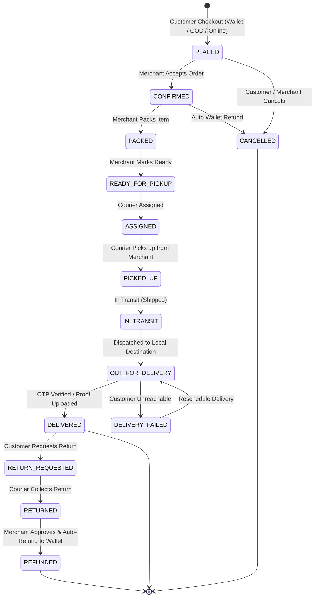

# EShoppingZone (ShopNexa) Microservices Architecture Guide

This document specifies the technical architecture, distributed system patterns, and lifecycle models implemented across the **EShoppingZone** e-commerce platform.

---

## 1. System Topology & Microservices Directory

| Service Name | Port | Primary Responsibility | Data Store |
| :--- | :---: | :--- | :--- |
| **Discovery Service** | `8761` | Netflix Eureka Service Registry & Health Discovery | In-Memory Registry |
| **API Gateway** | `8090` | Spring Cloud Gateway, request routing, rate limiting | Route Definitions |
| **Config Server** | `8888` | Centralized external configuration repository | Git / Classpath Native |
| **Storefront Web UI** | `8080` | Customer-facing Thymeleaf Storefront, Cart, Checkout | Client Session & Cache |
| **Profile Service** | `8081` | Authentication, RBAC, JWT, OAuth2 (GitHub/Google) | `eshopping_profile_db` |
| **Product Service** | `8082` | Catalog, Stock & Inventory, Reviews, Ratings, Reports | `eshopping_product_db` |
| **Cart Service** | `8083` | Shopping cart session state, item quantity updater | `eshopping_cart_db` |
| **Order Service** | `8084` | Order placement, returns, full 13-stage lifecycle | `eshopping_order_db` |
| **Wallet Service** | `8085` | E-Wallet deposits, withdrawals, refunds, statements | `eshopping_wallet_db` |
| **Notification Service**| `8086` | JavaMailSender HTML emails, event dispatching | `eshopping_notification_db` |
| **Merchant Service** | `8087` | Dedicated Seller Hub, product manager, fulfillment | Client / Upstream APIs |
| **Delivery Partner** | `8088` | Logistics Hub, live milestones, OTP delivery | `eshopping_delivery_db` |
| **Admin Service** | `8089` | Master Admin Control Center, moderation, reports | Client / Upstream APIs |

---

## 2. End-to-End 13-Stage Order Lifecycle State Machine



### Order Status Definitions:
1. `PLACED` / `PLACED_COD`: Order record created; inventory reserved.
2. `CONFIRMED`: Merchant or payment gateway confirms order.
3. `PACKED`: Merchant packages product in warehouse.
4. `READY_FOR_PICKUP`: Merchant stages parcel at dock.
5. `ASSIGNED`: Delivery partner assigned with pickup details.
6. `PICKED_UP`: Delivery agent collects package from merchant.
7. `IN_TRANSIT` / `SHIPPED`: Package in transit between hubs.
8. `OUT_FOR_DELIVERY`: Courier out on delivery route.
9. `DELIVERED`: Recipient enters delivery OTP; transaction finalized.
10. `CANCELLED`: Order stopped; wallet balance automatically refunded.
11. `RETURN_REQUESTED`: Customer submits return request with reason.
12. `RETURNED`: Merchant or courier receives returned product; stock restored.
13. `REFUNDED`: Customer wallet credited with full refund.

---

## 3. Distributed Architecture Patterns

### A. Saga Pattern (Distributed Transactions)
- **Order Placement Saga**:
  1. `order-service` creates order in `PLACED` state.
  2. `wallet-service` debits customer wallet (if mode is `WALLET`).
  3. `product-service` deducts item stock (`/stock/deduct`).
  4. `notification-service` dispatches confirmation email.
  - **Compensating Action**: If order is cancelled or return is approved, `wallet-service` executes `/deposit` to refund funds, and `product-service` executes `/stock/restore` to replenish inventory.

### B. Database-per-Service Pattern
Each domain microservice owns its private database schema (`eshopping_profile_db`, `eshopping_product_db`, `eshopping_order_db`, etc.). Direct cross-database joins are prohibited; inter-service communication flows through HTTP REST and Eureka service discovery.

### C. Idempotency Keys
Payment requests and order placement include client-generated or unique session keys preventing double-charging on network retries.

### D. Dead Letter Queue (DLQ) & Resilience
Failed email dispatches and courier notifications are captured into failure logs with automated retry logic, ensuring zero lost customer communications.

---

## 4. Deployment & DevOps

### Docker Compose
Run the entire platform including databases, discovery, gateway, and all 13 services:
```bash
docker compose up -d --build
```

### Kubernetes (k8s)
Deploy to any Kubernetes cluster:
```bash
kubectl apply -f k8s/eshoppingzone-configmap.yml
kubectl apply -f k8s/eshoppingzone-deployments.yml
kubectl apply -f k8s/eshoppingzone-services.yml
```

### CI/CD Pipeline
Configured in `.github/workflows/ci-cd.yml` with Maven build, unit test execution, Docker configuration validation, and Kubernetes dry-run verifications.
